# howdy, i'm hakko. 👋

**i write software, run servers, and make simple projects unnecessarily complicated.**

[website](https://hakko.dev) · [scuffed labs](https://github.com/ScuffedLabs) · [discord](https://discord.com/users/713900040879341589) · [twitch](https://twitch.hakko.dev) · [youtube](https://youtube.hakko.dev)

---

I started programming back in the day (2015) by messing around with Garry's Mod. One thing led to another and now I waste my time building random apps, running a hosting company, web stuff, games/mods and the infrastructure that keeps it all running, headaches included.

I have a bad habit of deciding I'd rather build my own tool than use one that already exists. Sometimes that works out, if it does it'll be posted here.

Most of my work is private or lives over at [Scuffed Labs](https://github.com/ScuffedLabs), so this profile isn't a complete record of everything I've made.

### things i'm building

- **[Morrow](https://github.com/HakkoDev/morrow)** · A desktop mail client. Because 🖕 Thunderbird <3.
- **[Alder](https://github.com/HakkoDev/Alder)** · A Git client. Because Because 🖕 GitKraken <3.

### things i'm involved in

- **[Prism Host](https://prismhost.co)** · A hosting company I founded in 2022. Games, websites, virtual servers, and all the infrastructure headaches that come with them. [GitHub](https://github.com/PrismHost).
- **[Scuffed Labs](https://scuffedlabs.com)** · A development collective I co-founded in 2023, making FiveM resources, tools, and other software. [GitHub](https://github.com/ScuffedLabs).
- **[Perimeter Gaming](https://perimetergaming.com)** · A gaming community and content creation group, probably best known for our FiveM roleplay server.

### the usual suspects

  

### elsewhere

If you're working on something interesting, want to collaborate, or just want to say hi, I'm easiest to reach on **[Discord (@hakkodev)](https://discord.com/users/713900040879341589)**.

And if anything I've made has been useful to you, there's always [Ko-fi](https://ko-fi.com/hakko). No pressure.

### github stats, for the number enjoyers

  
  

